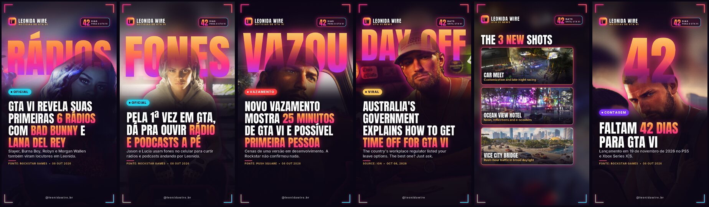
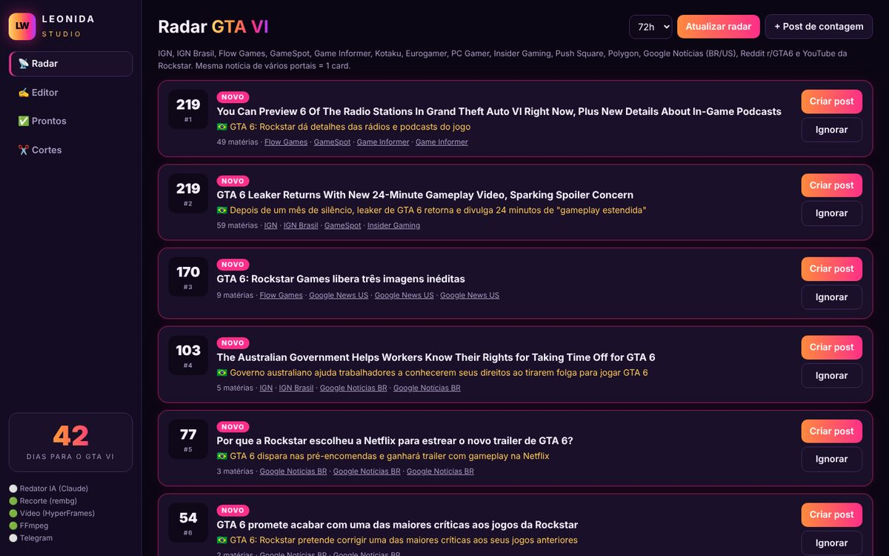
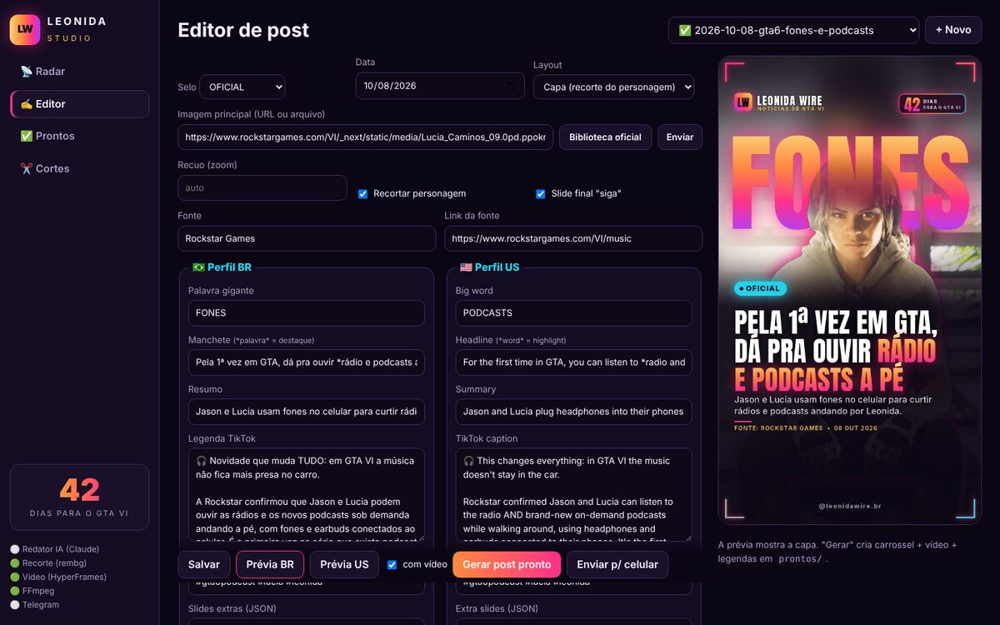

# 🌴 Leonida Studio — notícias GTA e cortes de gameplay

Produção de notícias verificadas de **GTA VI e da franquia GTA**: pesquisa os portais de games,
gera vídeos verticais de **30 a 60 segundos** (padrão 45 s), capa e legenda. **Português por padrão**;
inglês somente quando solicitado. A entrega é local no chat, para publicação manual no TikTok
e YouTube Shorts. As transições usam dissolução suave e o recorte dos personagens preserva as cores.

Rotina: **11h e 17h, America/Cuiaba**, até dois vídeos novos por rodada. O fluxo não repete
notícias já entregues e não publica em redes automaticamente. Consulte
[o prompt da automação](docs/AUTOMACAO-GTA.md) e
[o guia para outra conta](docs/CONTINUAR-EM-OUTRA-CONTA.md).

Dois aplicativos usam o mesmo repositório, com telas e saídas separadas:

| Aplicativo | Abrir no Windows | Endereço | Arquivos locais |
|---|---|---|---|
| **Leonida Notícias** | `scripts/abrir-noticias.bat` | <http://127.0.0.1:8768/> | Rascunhos em `posts/`, histórico em `state/`, entregas em `prontos/<data>/` |
| **Leonida Cortes** | `scripts/abrir-gameplay.bat` | <http://127.0.0.1:8769/> | Fontes em `apps/gameplay/uploads/`, projetos e exports em `apps/gameplay/prontos/` |

No Notícias, depois da exportação, o editor mostra **Vídeo completo pronto**, com reprodução,
**Abrir vídeo completo** e **Baixar MP4**. A aba **Prontos** também destaca o vídeo final
`br/tiktok/post.mp4` acima das imagens separadas da capa e das cenas.

O editor de cortes aceita link ou arquivo do computador e legenda a fala do criador pelo áudio,
inclusive fora da câmera. As legendas de voz ficam ativadas por padrão; revise a transcrição ou
forneça um SRT corrigido. Os projetos antigos e os vídeos já entregues permanecem nos caminhos
originais. A rotina diária de notícias continua independente dos cortes.

No Cortes, escolha **Tema de GTA VI**, **Sem música adicional** ou **Outra música** na importação
ou revisão. A faixa escolhida entra no vídeo exportado, mantendo o som original; o volume vai de
0 a 100%, com padrão de 10% e redução durante a fala. Outra música pode ser enviada em
MP3, WAV, M4A, AAC, FLAC ou OGG, até 512 MB. **Sem música adicional** preserva também qualquer
música já gravada na fonte; o editor não separa as faixas desse áudio.

**👉 Posts prontos:** [`prontos/`](prontos/) · Radar ao vivo: [`prontos/RADAR.md`](prontos/RADAR.md)

| | |
|---|---|
| 📡 **Radar** | IGN, IGN Brasil, Flow Games, TecMundo/Voxel, GameSpot, Game Informer, Kotaku, Eurogamer, PC Gamer, Push Square, Insider Gaming, Polygon, Google Notícias, Reddit r/GTA6 e YouTube da Rockstar. Junta a mesma notícia de vários sites e ranqueia por relevância. |
| 🎨 **Estilo próprio** | Paleta "Vice" (pôr do sol de Leonida), palavra gigante **atrás do personagem recortado**, manchete com destaque em gradiente, cantos neon, contador "X dias para o GTA VI". |
| 🎬 **Vídeo** | Motor v2 local (Pillow + FFmpeg), 30–60 s, dissoluções de 0,50 s, textos legíveis e **música tema** de fundo. Sem modelo pesado de interpolação. |
| 🎥 **Edição por link** | Mande um link: o app acha as cenas, reenquadra 9:16 no personagem e aplica movimentos de câmera estilo Higgsfield (crash zoom, dolly, câmera na mão, whip pan, câmera lenta) no HyperFrames, com grão de filme, marca e manchete BR/US. |
| ✂️ **Cortes** | Trailer/gameplay/vídeo viral (baixado com **yt-dlp**) → corte 9:16 com fundo desfocado, moldura da marca, escolha de música adicional e legenda automática. |
| 🎮 **Gameplay longa** | Link ou arquivo de 30 minutos ou mais → plano revisável dos momentos, vídeo horizontal de até 11 minutos, três shorts de 30–60 s e capas de quadros reais. Abra **Leonida Cortes**; [guia completo](docs/CORTES-GAMEPLAY.md). |
| ✍️ **Redação** | O Codex/Claude escreve no seu PC (veja `AGENTS.md`) ou o Claude API escreve sozinho na nuvem. |
| 🌐 **Site** | Cada post oficial vira matéria no site **Leonida Wire** (Vercel): imagem oficial limpa, texto, galeria e fontes. `python -m leonida site` gera a pasta `site/`. |
| 📲 **Entrega** | Pasta pronta por post + galeria com botão "copiar legenda" + envio opcional no Telegram/Discord. |

## Como fica



O app de notícias (as imagens abaixo mostram a interface anterior):

| Radar | Editor com prévia |
|---|---|
|  |  |

Cada post vira uma pasta:

```
prontos/2026-10-08/2026-10-08-gta6-radios-reveladas/
├── br/  01_capa.png  02_as-6-radios-de-leonida.png  03_o-que-sabemos.png  04_siga.png  video.mp4  legenda.txt
├── us/  01_cover.png 02_leonidas-first-6-stations.png 03_what-we-know.png 04_follow.png video.mp4  caption.txt
└── README.md   ← abre no GitHub mostrando tudo
```

## Instalação no PC (Windows)

1. Instale **Python 3.11+** (marque "Add to PATH"), **Node.js 22+** e **FFmpeg**:
   ```powershell
   winget install Python.Python.3.12 OpenJS.NodeJS.LTS Gyan.FFmpeg
   ```
2. Clone e instale:
   ```powershell
   git clone https://github.com/EDIMILSONDACUNHANOGUEIRA/sw-codex.git
   cd sw-codex
   python -m venv .venv; .venv\Scripts\activate
   pip install -r requirements.txt
   ```
3. Abra `scripts\abrir-noticias.bat` ou `scripts\abrir-gameplay.bat`. Para iniciar pelo terminal,
   execute, da raiz, cada comando em um terminal separado:
   ```powershell
   .venv\Scripts\python.exe -m uvicorn apps.noticias.app:app --host 127.0.0.1 --port 8768
   .venv\Scripts\python.exe -m uvicorn apps.gameplay.app:app --host 127.0.0.1 --port 8769
   ```
4. Para as legendas automáticas da fala, configure as dependências locais de reconhecimento
   descritas em [Cortes de gameplay](docs/CORTES-GAMEPLAY.md#legendas-da-fala). Um SRT revisado
   pode ser usado sem o modelo de reconhecimento.
5. Para a rotina de notícias às 11h e 17h de Cuiabá, siga
   [a configuração da automação](docs/AUTOMACAO-GTA.md). O editor de cortes não agenda vídeos.

`python -m leonida serve` e `scripts/abrir-studio.bat` mantêm o aplicativo legado; use os dois
iniciadores acima para trabalhar com os aplicativos separados.

(macOS/Linux: `brew install python node ffmpeg` ou `apt install ffmpeg nodejs`, e `source .venv/bin/activate`.)

> Na primeira vez o recorte de personagem baixa um modelo de ~170 MB e o vídeo baixa o Chrome do
> HyperFrames. Depois fica tudo local.

## Usando com o Codex (ou Claude Code)

Abra a pasta no Codex e peça, por exemplo:

- *"Faz os posts de hoje"* → roda o radar, confere as fontes, escreve em português e gera os arquivos.
- *"Cria o post da notícia 2 do radar"*
- *"Faz um corte do trailer de 1:12 a 1:24 com a manchete 'Jason em primeira pessoa'"*
- *"Edite esta gameplay: LINK. Gere até 11 minutos para YouTube, três shorts de 45 segundos e as capas."*

As regras de redação, o estilo e o formato dos arquivos estão no [`AGENTS.md`](AGENTS.md).

## Comandos

```bash
python -m leonida radar                  # notícias do momento (ranking)
python -m leonida rascunho 1             # cria posts/<id>/post.yaml da notícia nº 1
python scripts/produzir_rotina.py <post-id>  # PT, 30–60 s e QA; inglês somente com --lang en
python -m leonida build <post-id>        # comando geral de renderização (idiomas configurados)
python -m leonida build <post-id> --sem-video   # sem capa animada; ainda gera tiktok/post.mp4 com a música tema
python -m leonida contagem               # post "faltam X dias" com screenshot oficial
python -m leonida corte URL 0:42 1:05 --pt "Manchete *destaque*" --en "Headline *highlight*" --credito "Rockstar Games"
python -m leonida editar URL --pt "Manchete *BR*" --en "Headline *US*"   # edição 9:16 estilo Higgsfield
python -m leonida musica URL --inicio 0:12 --nome trailer-1   # música tema (obrigatória)
python -m leonida auto                   # radar → redação (Claude) → render → envio
python -m leonida site                   # gera o site de notícias (site/, publicado na Vercel)
python -m leonida galeria                # atualiza prontos/index.html
python -m uvicorn apps.noticias.app:app --host 127.0.0.1 --port 8768  # notícias
python -m uvicorn apps.gameplay.app:app --host 127.0.0.1 --port 8769  # cortes de gameplay
python -m leonida serve                  # app web legado
```

## 🎵 Música das notícias e dos cortes

Todo post da rotina de notícias sai com a **música tema de GTA VI**, nunca com música aleatória. Como a API do TikTok não
deixa escolher a música de um post de fotos, o carrossel é publicado como **vídeo**
(`prontos/<data>/<post>/br/tiktok/post.mp4`): a capa e os slides em sequência, com a música tema
embutida. A "música automática" do TikTok fica sempre desligada.

Baixe as músicas uma vez no seu PC (link do trailer oficial no YouTube e o segundo em que a música começa).
Pode ter mais de uma; o app alterna entre elas, uma por post:

```bash
python -m leonida musica "https://www.youtube.com/watch?v=..." --inicio 0:12 --nome trailer-1
python -m leonida musica "https://www.youtube.com/watch?v=..." --inicio 0:05 --nome trailer-2
python -m leonida musica --arquivo tema.mp3 --nome minha-faixa   # se já tiver o arquivo
python -m leonida musica --listar
```

Os arquivos ficam só no seu PC (`assets/music/`, fora do GitHub). **Sem nenhuma música tema, o vídeo do
post não é gerado e nada é publicado automaticamente.** Essa regra permanece na rotina diária.
O **Leonida Cortes** usa a escolha de música e volume feita na importação ou revisão:
tema, nenhuma faixa adicional ou outra faixa local. O áudio original permanece na exportação,
e a música adicional é misturada por baixo, com redução durante a fala. Veja
[as opções de música dos cortes](docs/CORTES-GAMEPLAY.md).

> ⚠️ A música dos trailers é protegida por direitos autorais e o TikTok pode silenciar um vídeo. Se
> acontecer, poste o mesmo vídeo à mão e escolha o **som oficial do trailer de GTA VI na biblioteca do
> TikTok**, nunca um som aleatório.

## ⬇️ Vídeos do YouTube (yt-dlp)

Os cortes usam o [**yt-dlp**](https://github.com/yt-dlp/yt-dlp) — o sucessor do youtube-dl, o
repositório mais usado para baixar vídeos do YouTube (também X/Twitter, Reddit, TikTok, Twitch…).
Já vem no `requirements.txt` com o componente de JavaScript que o YouTube passou a exigir, e usa o
Node.js que você instalou. Se o YouTube pedir login ("confirm you're not a bot"), rode antes:

```powershell
$env:LEONIDA_YTDLP_BROWSER="chrome"   # usa os cookies do seu navegador (chrome, edge, firefox)
```

## 🔍 Qualidade de imagem

- **Sem cara de IA:** nada de contorno neon no personagem. Ele projeta sombra na palavra gigante, a
  luz do fundo invade a borda do recorte, a máscara segue o cabelo, e a arte inteira ganha grão de
  filme e halação. Ajuste em `config/brand.yaml → acabamento` (`neon: true` volta ao visual antigo).

- Artes em **1080×1920** (máximo do TikTok para fotos), PNG sem perda, com nitidez aplicada.
- Fotos pequenas (ex.: imagem de matéria em 1280×720) são ampliadas antes do recorte. Para upscale
  **com IA**, baixe o `realesrgan-ncnn-vulkan` nos Releases do
  [Real-ESRGAN](https://github.com/xinntao/Real-ESRGAN) e coloque no PATH (ou defina `REALESRGAN_BIN`).
- A seleção prioriza screenshots oficiais pertinentes ao assunto. Confira o personagem e a cena:
  a resolução alta, sozinha, não torna uma imagem adequada para a notícia.
- Vídeos em qualidade alta, 12 Mbps (`LEONIDA_VIDEO_BITRATE` para mudar).

### Capa e imagens do vídeo

No **Leonida Notícias**, abra **Biblioteca oficial** e use **Foto da capa** para escolher a
miniatura principal. Para rostos e screenshots horizontais, prefira **Foto inteira (recomendado)**
(`layout: card`): mantém a fotografia sem recortar ou reconstruir o personagem. Confira a prévia
antes de gerar.

Em **+ Escolher imagens oficiais**, selecione **Imagem do vídeo** e adicione **3–6 fotos de apoio
diferentes**, relacionadas à pauta. As miniaturas permitem conferir e remover cada escolha.
A foto da capa e as imagens já selecionadas não podem ser adicionadas novamente pela biblioteca.
Os arquivos também podem ser definidos no `post.yaml`:

```yaml
layout: card
video_segundos: 45
visuals:
  - {image: "URL_OFICIAL_DA_FOTO_1", credit: "Rockstar Games", label: "Imagem oficial ilustrativa"}
  - {image: "URL_OFICIAL_DA_FOTO_2", credit: "Rockstar Games", label: "Imagem oficial ilustrativa"}
  - {image: "URL_OFICIAL_DA_FOTO_3", credit: "Rockstar Games", label: "Imagem oficial ilustrativa"}
```

Substitua os três campos `URL_OFICIAL...` por URLs reais copiadas da biblioteca.
O campo opcional `text` mostra uma frase curta junto à foto, editável em
**Texto desta cena**. Quando ele está vazio, o vídeo usa os fatos já escritos nos slides,
se disponíveis. A edição abre com a capa, alterna as fotos de apoio e os slides de fatos verificados e fecha com a CTA, quando
ativada. Nas notícias v2 de 30 segundos ou mais, cada cena tem limite de **7 segundos**. Fotos
distintas podem voltar em momentos separados para completar a duração; capa e CTA não se repetem
para preencher tempo. Listas extensas preservam o tempo mínimo de leitura e registram essa exceção
no log; prefira dividir o conteúdo em slides curtos.

Se faltar variedade para a duração escolhida, a geração pede **mais imagens ou slides**. Ela não
estica uma capa por 30 segundos. Revise a capa e os quadros das trocas; para corrigir uma entrega,
crie uma versão nova e preserve os vídeos anteriores. Imagens ilustrativas oficiais não são prova
da notícia nem quadros de um suposto vazamento: mantenha essa indicação no rótulo e no texto.

## Automação e GitHub Actions

A rotina atual pesquisa às **11h e 17h de Cuiabá** e entrega os arquivos localmente para
publicação manual. Ela precisa ser recriada no Codex ao trocar de conta, conforme
[docs/AUTOMACAO-GTA.md](docs/AUTOMACAO-GTA.md). Não depende de notificações ou publicação externa.

Os workflows em `.github/workflows/` têm escopos diferentes:

- **radar.yml** — consulta apenas feeds públicos às 15h e 21h UTC e atualiza `state/radar.json`
  e `prontos/RADAR.md`. Não gera vídeos nem envia notificações; a geração e revisão são locais.
- **contagem.yml** — fluxo legado de contagem às 07h52 de Brasília, com opção de envio por
  integrações. Ele não faz parte da rotina atual de entrega local.
- **pages.yml** — fluxo legado de publicação da galeria `prontos/` no GitHub Pages.

Uma agenda do Actions só funciona quando o workflow está no branch padrão e o Actions está
habilitado. A presença dos arquivos nesta branch não comprova execução. Envio por integrações,
publicação da galeria e deploy exigem autorização explícita; não são necessários para os dois apps.
Credenciais opcionais ficam em variáveis de ambiente ou Secrets do GitHub, nunca no código.

## Personalizar

- `config/brand.yaml` — nome da marca, @ dos perfis BR/US, paleta, selos, áreas seguras do TikTok.
- `config/sources.yaml` — portais monitorados, palavras que dão prioridade.
- Detalhes técnicos e repositórios usados: [`docs/REPOS.md`](docs/REPOS.md).

## Direitos e boas práticas

As imagens usadas são screenshots e artes **oficiais divulgadas pela Rockstar Games** para imprensa e fãs,
sempre com crédito. Nos cortes, use trechos curtos com comentário/edição própria e crédito ao autor.
Não publique material vazado nem conteúdo explícito. GTA VI e todas as marcas pertencem à Rockstar
Games/Take-Two; este projeto não é afiliado a elas.
