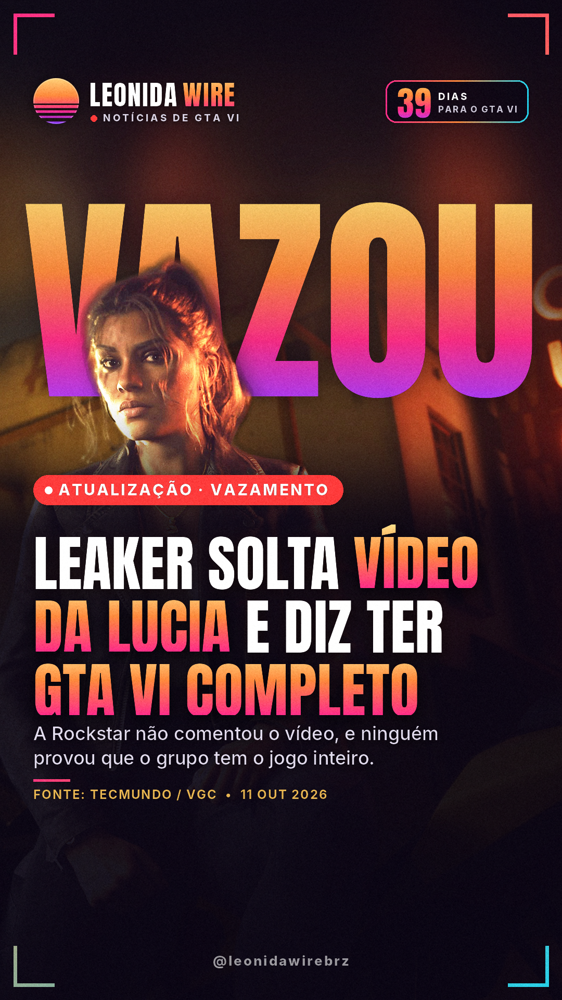
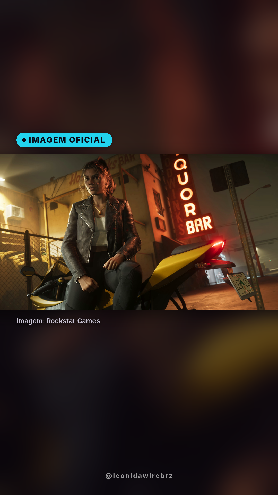
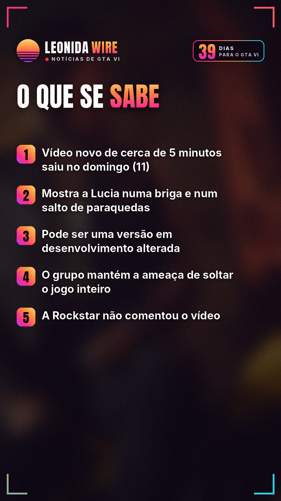
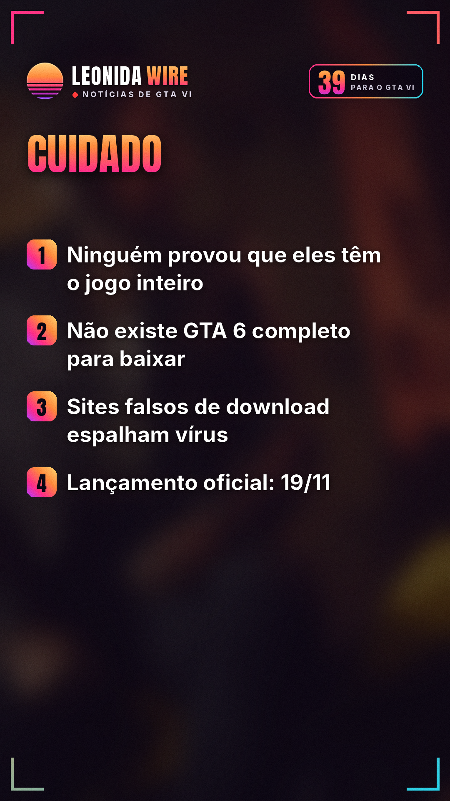
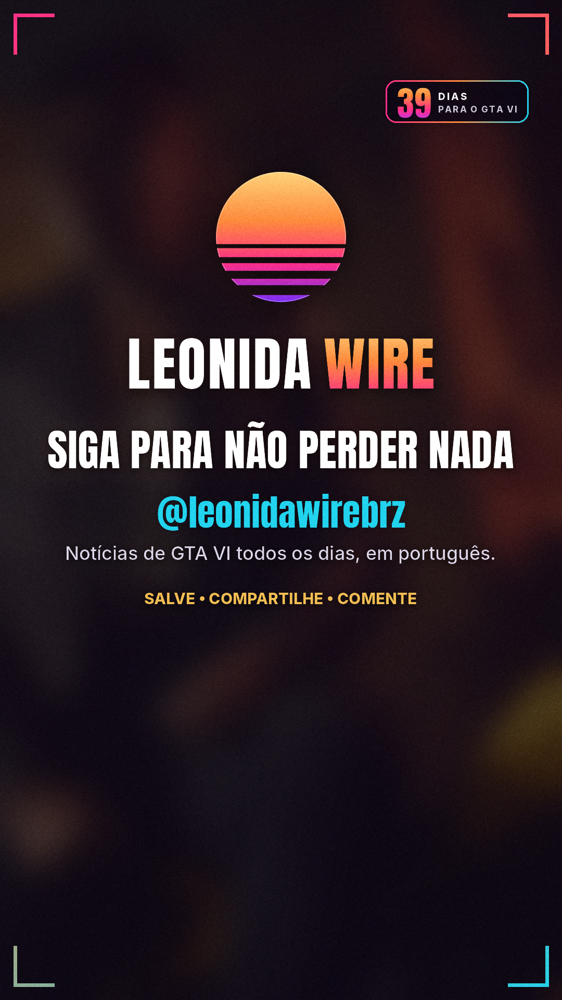

# Leaker solta vídeo da Lucia e diz ter GTA VI completo

Fonte: [TecMundo / VGC](https://www.estadao.com.br/tecmundo/voxel/cyberleek-vaza-gameplay-de-gta-6-com-lucia-nua-e-ameaca-liberar-build-completa-do-jogo/)

## 🇧🇷 Perfil BR

    

```
Atualização: depois da ameaça de ontem, o grupo Cyberleek soltou um novo vídeo não oficial de GTA VI com a Lucia.

O vídeo tem cerca de 5 minutos e saiu neste domingo (11).

Mostra a Lucia numa briga, num caixa eletrônico e num salto de paraquedas do alto de um prédio.

Ele tem cenas para adultos, então aqui não mostramos nada dele.

O TheGamer e fãs citados pelo Dexerto apontam que pode ser uma versão em desenvolvimento usada com ferramentas de teste.

A ameaça continua: o grupo diz que solta a campanha inteira, "até os créditos", se uma criptomoeda ligada a ele bater uma meta de valor de mercado.

A "saída" para a Take-Two, segundo o grupo: discos físicos e um pedido público de desculpas.

⚠️ Nada confirmado: a Rockstar não comentou o novo vídeo, e ninguém provou que o grupo tem o jogo inteiro. A Take-Two já foi à Justiça pedir dados ao Discord para achar os responsáveis.

🛑 Cuidado: não existe "GTA 6 completo" para baixar. Sites falsos de download já espalham vírus que rouba senhas. E não invista em moeda de leaker.

GTA VI chega oficialmente em 19/11 para PS5 e Xbox Series X|S.

Você acha que eles têm mesmo o jogo inteiro? 👇

Fonte: TecMundo / VGC

#gta6noticias #rockstargames #golpe #segurancadigital #gta6 #gtavi #gta6brasil #noticiasgamer
```
