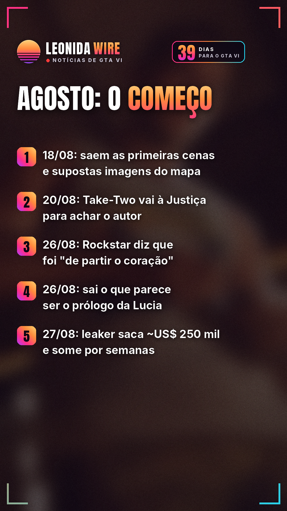
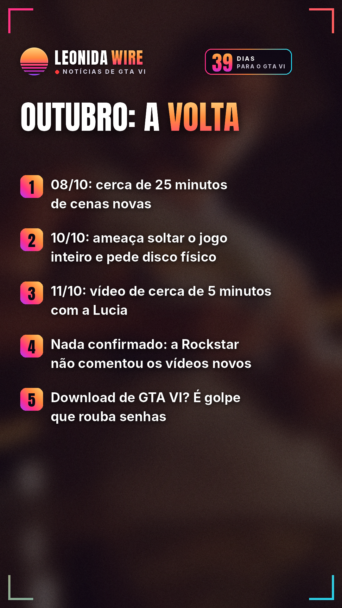
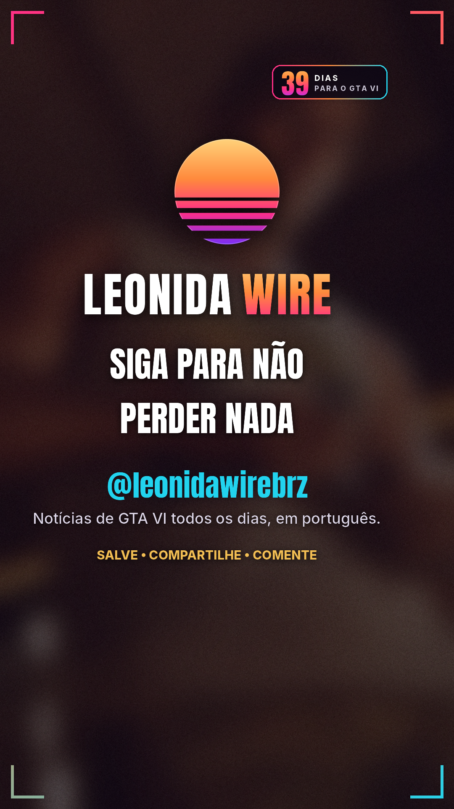

# GTA VI: a saga dos vazamentos

Fonte: [Kotaku / VGC / Insider Gaming](https://kotaku.com/gta-6-leaker-threatens-rockstar-with-doomsday-scenario-if-meme-coin-hits-30-million-2000743779)

## 🇧🇷 Perfil BR

   

🎬 Vídeo com música: [br/tiktok/post.mp4](br/tiktok/post.mp4)

```
Do primeiro vídeo à ameaça de soltar o jogo inteiro: a linha do tempo dos vazamentos de GTA VI.

18/08: um leaker anônimo (não se sabe se é uma pessoa ou um grupo) começa a postar cenas de gameplay e imagens que diz serem do mapa. Diz protestar contra a pré-venda só digital.

20/08: a Take-Two pede à Justiça federal dos EUA, em Nova York, que obrigue a Microsoft e o Discord a entregar dados para identificar o responsável.

26/08: em post no X, a Rockstar afirma que ver o gameplay vazar assim foi "de partir o coração" para a equipe e diz esperar que todos aguardem um pouco mais para jogar em 19/11. No mesmo dia, sai um vídeo do que parece ser o prólogo da Lucia.

27/08: a Rockstar mostra o jogo oficialmente num especial da Netflix. Segundo Kotaku e Dexerto, o leaker sacou cerca de US$ 250 mil de uma criptomoeda ligada a ele, que despencou. Depois, sumiu por semanas.

08/10: solta cerca de 25 minutos de cenas novas. Em seguida, abre uma enquete para escolher o próximo vídeo.

10/10: ameaça soltar a campanha inteira se a moeda bater uma meta de valor de mercado. A "saída" para a Take-Two, segundo ele: disco físico e um pedido público de desculpas.

11/10: novo vídeo, de cerca de 5 minutos, com a Lucia.

⚠️ Nada confirmado: ninguém provou que ele tem o jogo inteiro, e a Rockstar não comentou os vídeos de outubro nem a ameaça.

🛑 Cuidado: não existe GTA VI para baixar. Sites falsos de download espalham vírus que rouba senhas. E não invista em moeda de leaker.

GTA VI chega oficialmente em 19/11 para PS5 e Xbox Series X|S.

Essa história acaba antes do lançamento? 👇

Fonte: Kotaku / VGC / Insider Gaming

#gta6noticias #rockstargames #golpe #segurancadigital #gta6 #gtavi #gta6brasil #noticiasgamer
```
