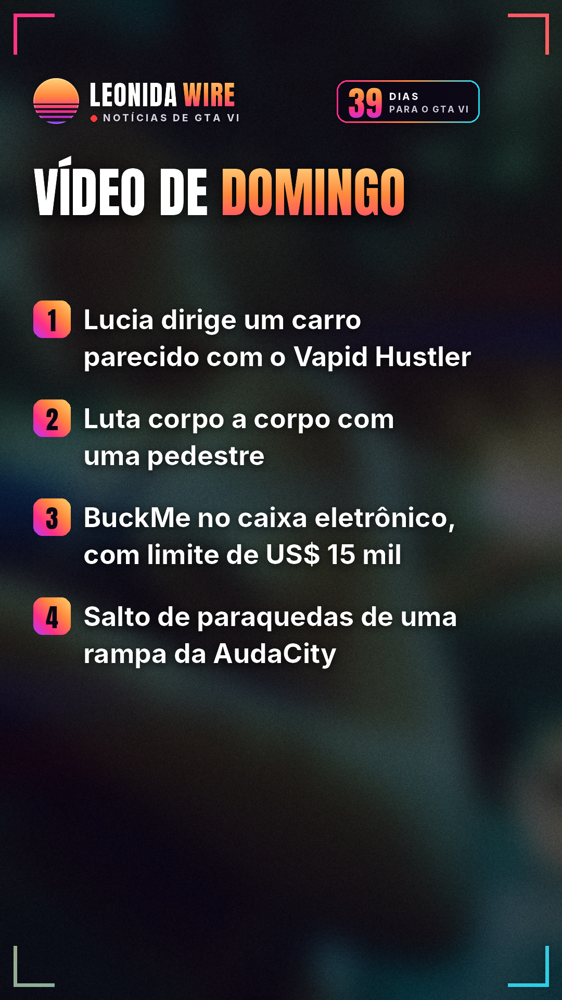
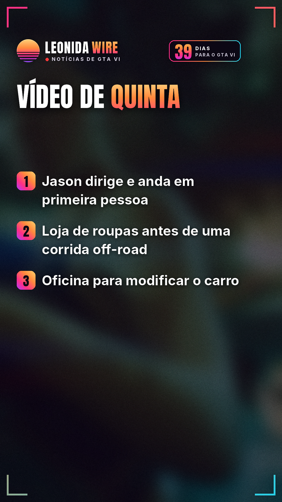
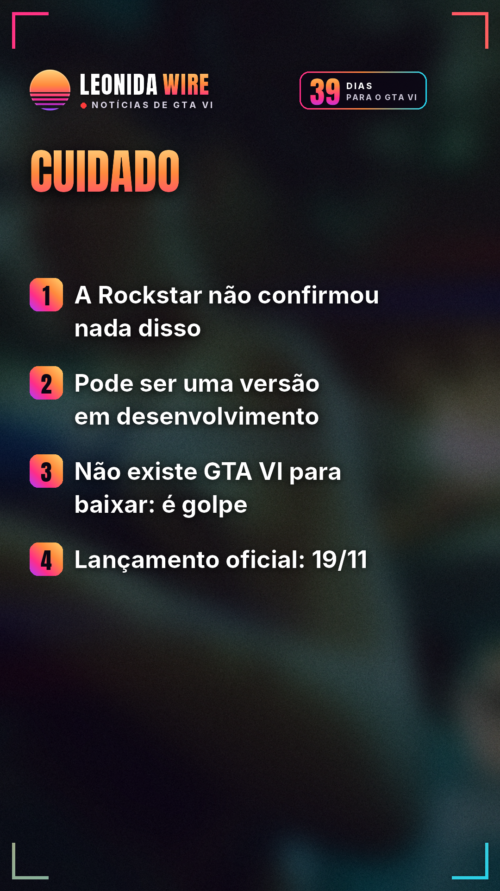

# Vazamentos de GTA VI: o resumo

Fonte: [Dexerto / TecMundo / Insider Gaming](https://insider-gaming.com/gta-6-first-person-seemingly-revealed-new-leak/)

## 🇧🇷 Perfil BR

    

🎬 Vídeo com música: [br/tiktok/post.mp4](br/tiktok/post.mp4)

```
O que os vídeos vazados de GTA VI desta semana mostram de gameplay, segundo a imprensa de games 👀

Nada disso foi confirmado pela Rockstar. Pode ser uma versão em desenvolvimento, diferente do jogo final.

Vídeo de domingo (11), com cerca de 5 minutos:
• Lucia dirige um carro que parece ser um Vapid Hustler, em Vice City (TheGamer e TecMundo)
• Luta corpo a corpo com uma pedestre (TheGamer e TecMundo)
• A tela de um caixa eletrônico mostra a BuckMe, app de pagamento fictício do jogo, e um limite de US$ 15 mil (TheGamer e TecMundo)
• Salto de paraquedas de uma rampa da AudaCity, no alto de um prédio (Dexerto, TheGamer e TecMundo)
• O vídeo termina com um comercial da BuckMe (Dexerto e TecMundo)

Vídeo de quinta (8), com cerca de 25 minutos:
• Jason dirige e anda em primeira pessoa (Insider Gaming e Dexerto)
• Uma corrida off-road (Insider Gaming, MP1st e Notebookcheck)
• Antes da corrida, ele compra roupa numa loja (MP1st e Notebookcheck)
• Oficina para modificar o carro (MP1st e Notebookcheck)

A Rockstar não confirmou modo em primeira pessoa para o lançamento.

🛑 Cuidado: não existe GTA VI para baixar. Sites falsos de "download" espalham vírus que rouba senhas.

GTA VI chega oficialmente em 19/11 para PS5 e Xbox Series X|S.

Qual desses detalhes você quer ver no jogo final? 👇

Fonte: Dexerto / TecMundo / Insider Gaming

#gta6noticias #rockstargames #vicecity #golpe #gta6 #gtavi #gta6brasil #noticiasgamer
```
