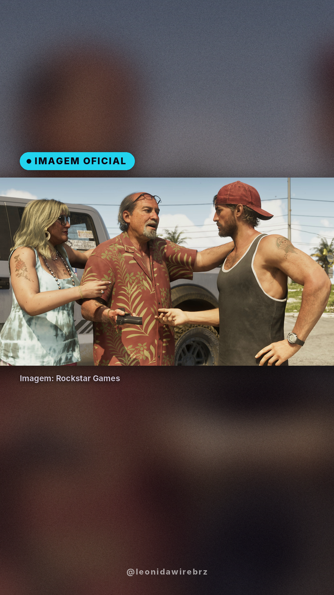
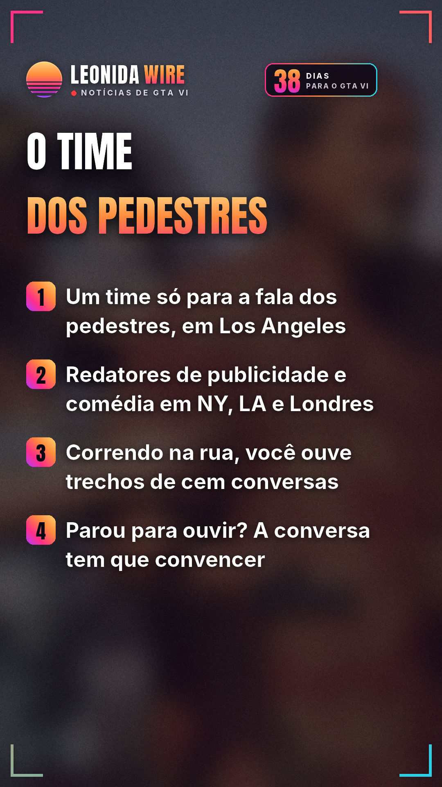

# GTA VI tem time de roteiristas só para os pedestres

Fonte: [LOVE Magazine](https://lovemagazine.net/articles/gta-vi-the-american-dream)

## 🇧🇷 Perfil BR

    

🎬 Vídeo com música: [br/tiktok/post.mp4](br/tiktok/post.mp4)

```
🗣️ GTA VI tem um time de roteiristas só para o que os pedestres falam.

Em entrevista à LOVE Magazine, Rupert Humphries, vice-presidente sênior de narrativa da Rockstar, contou que existe uma equipe específica de roteiristas de diálogos de pedestres em Los Angeles.

E mais um time de redatores de publicidade e comédia em Nova York, Los Angeles e Londres. "E nenhum de nós vê isso como pano de fundo!", disse ele.

James Horton, diretor de roteiro do mundo aberto, disse que "não existem atalhos" para criar um mundo assim: correndo pela rua mais movimentada, você ouve trechos de cem conversas diferentes. Se parar para escutar uma delas, ela tem que convencer.

"Ninguém que você encontra é figurante", disse Horton. "Todo mundo que você encontra é o protagonista da própria história."

GTA VI chega em 19/11.

Você vai parar para ouvir a conversa dos NPCs? 👇

#gta6npc #gta6curiosidades #rockstargames #gta6 #gtavi #gta6brasil #noticiasgamer
```
