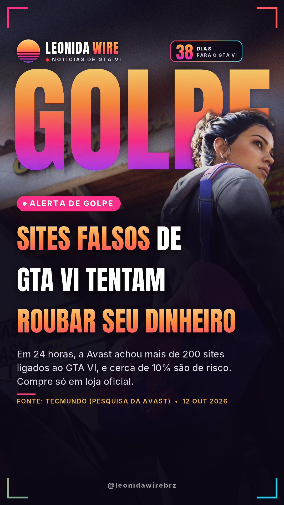
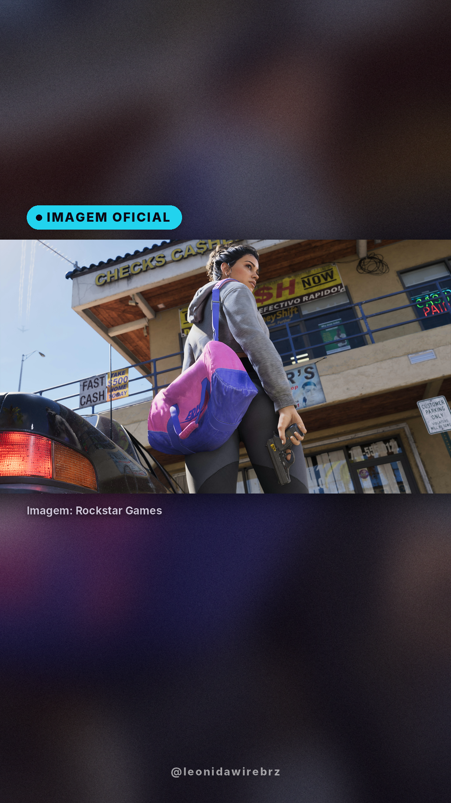
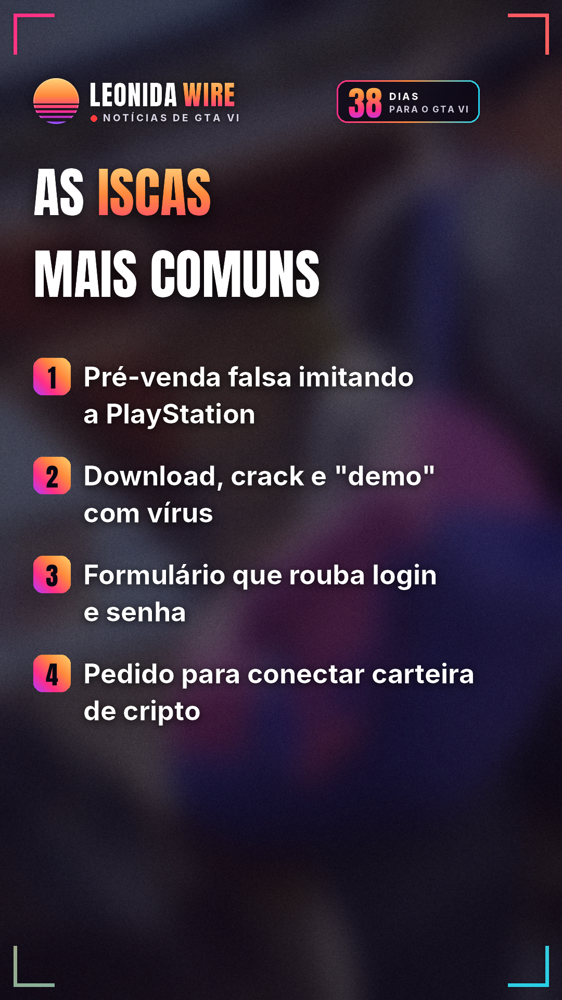
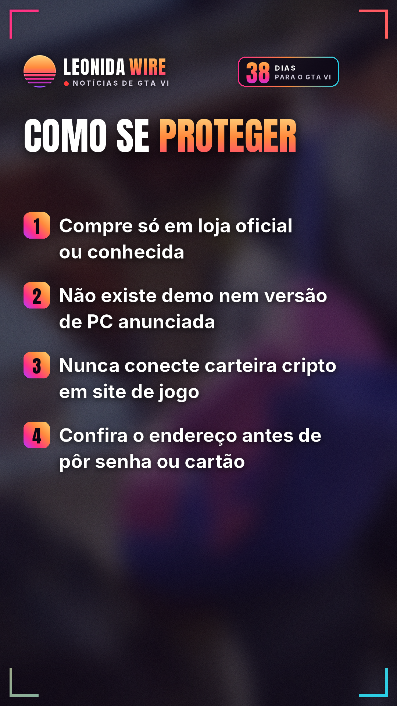
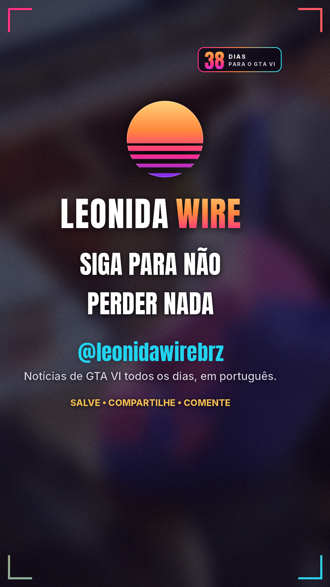

# Sites falsos de GTA VI tentam roubar seu dinheiro

Fonte: [TecMundo (pesquisa da Avast)](https://www.estadao.com.br/tecmundo/ciberseguranca/dezenas-de-sites-falsos-de-gta-6-tentam-roubar-gamers-veja-dominios/)

## 🇧🇷 Perfil BR

    

🎬 Vídeo com música: [br/tiktok/post.mp4](br/tiktok/post.mp4)

```
🚨 Cuidado: tem site falso de GTA VI tentando levar seu dinheiro e sua senha antes mesmo do lançamento.

Em um levantamento de 24 horas, a Avast achou mais de 200 sites ligados ao GTA VI. Cerca de 10% são de risco alto ou médio, segundo o TecMundo.

As iscas: pré-venda falsa, download ou crack, formulário que rouba login, cobrança por produto falso e pedido para conectar carteira de cripto.

Um dos sites imita a loja da PlayStation para "vender" a Ultimate Edition. Outro divulga um token de cripto "de GTA" sem nenhum vínculo com a Rockstar.

Em agosto, a Malwarebytes já tinha flagrado sites de "demo de GTA 6" que espalham o Vidar, vírus que rouba senhas e sessões do navegador.

Como se proteger:
Compre só na PlayStation Store, na Microsoft Store ou em loja conhecida.
Não existe demo nem download antecipado fora das lojas oficiais, e GTA VI não tem versão de PC anunciada.
Nunca conecte carteira de cripto em site de jogo.
Confira o endereço antes de digitar senha ou cartão.

GTA VI chega em 19/11 para PS5 e Xbox Series X|S.

Já te ofereceram algum golpe desses? 👇

Fonte: TecMundo (pesquisa da Avast)

#golpe #segurancadigital #sitesfalsos #avast #gta6 #gtavi #gta6brasil #rockstargames #noticiasgamer
```
